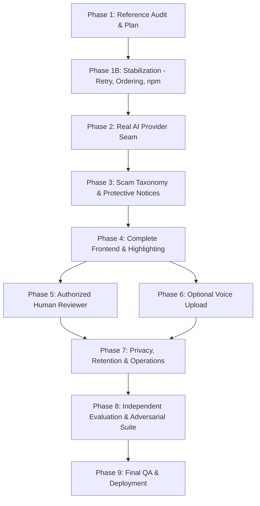

# ScamFlow AI — Product Implementation Plan

**Date:** 2026-10-25  
**Baseline Commit:** `c4f1b6b5f83e9669b8c8044c2da7ac42a0de89a1` (`main`)  
**Status:** Working blueprint for post-Phase-1 development  

---

## 1. Existing Verified ScamFlow Capabilities

As established by the Phase 0 baseline verification and Phase 1 audit, ScamFlow AI currently possesses a robust, working core foundation with 133 backend unit/integration tests, 8 frontend tests, and 2 Chromium E2E tests passing.

### Core Architectural Guarantees Already Implemented

| Capability | Implementation File | Verification / Behavior |
|---|---|---|
| **Explicit Consent Enforcement** | `models.py`, `services.py`, `App.tsx` | Evidence cannot be persisted without explicit user opt-in (`consent: true`). Unconsented requests fail with 400. |
| **Session Ownership Boundaries** | `security.py`, `database.py`, `models.py` | Cases and assessments belong to anonymous cookie-bound sessions (`owner_id`). Cross-tenant access returns 404. |
| **CSRF Defense** | `app.py`, `api.ts` | All state-mutating requests require `X-ScamFlow-CSRF: 1` header, preventing cross-site form/script submissions. |
| **Immutable Revisions & Provenance** | `models.py`, `services.py` | Interactions are appended as new ordered events with incrementing revision numbers; past events are never edited. |
| **Exact Evidence Span Grounding** | `schemas.py`, `extractors.py`, `models.py` | Every finding must link to an exact substring in submitted text (`quote`, `offset`, `length`). Hallucinated quotes fail validation. |
| **Deterministic Rule Evaluation** | `detection.py`, `assessment_services.py` | Hybrid pipeline: observations extracted from spans, then deterministic Python rules evaluate scam tactics (Digital Arrest, Fake Refund). |
| **Alert Memory & Dedup** | `models.py`, `assessment_services.py` | System remembers previously fired alerts per case; prevents alarm fatigue by suppressing redundant warnings across revisions. |
| **Hard Deletion & Expiry Semantics** | `services.py`, `models.py` | Users can delete cases; cascades wipe events, assessments, and evidence. Retains only anonymized hashed retry metadata. |
| **Request Idempotency** | `services.py`, `models.py` | Mutations require `Idempotency-Key`. Replays return cached responses; payload mismatches return `409 idempotency_conflict`. |
| **Incremental Synthetic Replay** | `App.tsx`, `demos.ts` | Guided testing in frontend allows step-by-step submission and reassessment of multi-turn scenarios. |

---

## 2. Phase 1B — Stabilization Scope

Phase 1B is strictly a stabilization phase to fix verified baseline defects before adding any new features or provider integrations.

### Task A: Frontend Retry / Idempotency Conflict Fix

- **Affected Endpoints:** `POST /cases`, `POST /cases/{case_id}/events`
- **Relevant Files:**
  - Frontend: `frontend/src/App.tsx`, `frontend/src/api.ts`
  - Backend: `backend/scamflow/services.py`, `backend/scamflow/models.py`
- **Likely Root Cause:** In `frontend/src/App.tsx`, `create` (line 151) and `append` (line 167) generate a new idempotency key on first attempt and store it in `retryKeys`. However, on every retry invocation, `crypto.randomUUID()` is called anew for `event_id` (line 155 and line 168). The backend `_fingerprint` hashes the serialized payload (including `event_id`). When a request fails or times out and the user clicks retry, the same `Idempotency-Key` is sent with a different `event_id`, triggering `409 idempotency_conflict`.
- **Current Idempotency Behavior:** Backend correctly enforces that identical keys require identical payloads. Frontend violates this contract by regenerating event UUIDs during retries.
- **Expected Correct Behavior:** Frontend must retain both the idempotency key and the exact event payload (preserving `event_id`) in `retryKeys` until the mutation succeeds, or the form is reset/cancelled.
- **Required Regression Tests:**
  - Frontend test in `frontend/src/App.test.tsx`: Simulate a network failure on `createCase` or `append`, trigger retry, and verify that the outgoing HTTP request uses the exact same `Idempotency-Key` AND the exact same `event_id` as the initial attempt.
  - Backend integration test in `backend/tests/test_mutations.py`: Verify that retrying with identical key and identical payload succeeds (returns 200/201 or cached response), whereas differing payload produces 409.

### Task B: Deterministic Latest-Assessment Ordering

- **Affected Endpoints:** `GET /cases/{case_id}/assessment`
- **Relevant Files:** `backend/scamflow/assessment_services.py`, `backend/scamflow/models.py`
- **Current Database Fields:**
  - `assessments.created_at`: Integer (second-resolution unix timestamp).
  - `assessments.id`: String(32) (random hex UUID).
  - `assessments.assessed_revision`: Integer.
- **Current Query Logic:** `assessment_services.py:704`:
  ```python
  select(Assessment)
  .where(Assessment.case_id == case.id, Assessment.owner_id == owner_id)
  .order_by(Assessment.created_at.desc(), Assessment.id.desc())
  .limit(1)
  ```
- **Why Same-Second Entries are Ambiguous:** When two assessments for the same case occur within the same second (e.g. rapid re-assessment, or reassessment across revisions during automated testing/scripts), `created_at` is identical. Ordering by `Assessment.id.desc()` sorts by random UUID strings lexicographically, meaning an earlier assessment with a higher hexadecimal ID will sort *after* a newer assessment with a lower hexadecimal ID.
- **Smallest Deterministic Fix:** Add a deterministic tie-breaker to the query order clause:
  `ORDER BY Assessment.created_at.desc(), Assessment.assessed_revision.desc(), Assessment.rowid.desc()` (or ordering by SQLite `rowid.desc()` as the ultimate insertion-order guarantee, or adding an autoincrement integer sequence column).
- **Migration Impact:** If utilizing SQLite `rowid` and `assessed_revision`, zero schema migration is required. If adding an explicit `sequence_number` column, a single schema migration adding the column with autoincrement is needed.
- **Required Regression Tests:**
  - Test in `backend/tests/test_assessments.py`: Mock `system_clock()` to return an identical timestamp for two consecutive assessments on the same case, assign descending UUIDs to the assessments, and verify that the query deterministically returns the second (latest) assessment.

### Task C: npm High-Severity Development Advisory Remediation

- **Advisory Identifiers:** GHSA-4qv8-2p9j-2685 (EventSource memory exhaustion), GHSA-f72v-6w45-q472 (Subresource Integrity algorithm-token handling), GHSA-xjj6-f33q-929c (excessive content-encoding error handling).
- **Vulnerable Package:** `undici`
- **Installed Version:** `8.11.2`
- **Dependency Path:** `scamflow-ai-frontend -> devDependency jsdom@30.1.2 -> undici@8.11.2`
- **Direct vs Transitive:** Transitive dependency through `jsdom`.
- **Runtime vs Development-Only:** Development-only. `jsdom` is used strictly by `vitest` for emulating DOM APIs in test environments; neither `jsdom` nor `undici` is bundled into the production Vite build (`dist/assets`).
- **Patched Version:** `undici >= 8.16.0` (or `jsdom` release pinning patched `undici`).
- **Smallest Compatible Remediation:** Add an `"overrides"` block in `frontend/package.json` targeting `"undici": ">=8.16.0"`, then run standard `npm install` without `--force`. Verify `vitest` tests pass cleanly. Do NOT run `npm audit fix --force`.

---

## 3. Phase 2 — Real AI Provider Integration

- **Goal:** Replace the mock extractor fixture with a production-grade LLM provider adapter (e.g. Gemini API or Anthropic Claude API) behind the existing provider seam, enforcing exact quote grounding, timeouts, and token limits.
- **Dependencies:** Provider SDK or HTTP client (`httpx`), API key configuration in settings.
- **Source Areas Likely Affected:**
  - `backend/scamflow/extractors.py`: Implement real provider adapter class satisfying `ExtractorProviderProtocol`.
  - `backend/scamflow/settings.py`: Provider API key, model name, endpoint, request timeout, and retry settings.
  - `backend/scamflow/detection.py`: Update mock wording and provider version identifiers.
  - `backend/tests/test_provider_contract.py`: Add live/mocked provider contract tests.
- **Reference-Project Ideas Used:**
  - Conceptual prompt structuring from SignalShield Africa (structured JSON response schema, tactic descriptions) adapted to ScamFlow's quote-span contract.
- **Security & Privacy Concerns:**
  - Zero-retention provider agreement where possible; API key stored in environment, never in code or database.
  - Sanitize inputs to avoid prompt injection attacks.
  - LLM output must be treated as untrusted: all extracted quote spans MUST be validated against submitted text before acceptance.
- **Acceptance Criteria:**
  - Real LLM extracts observation types, evidence quote strings, and character offsets.
  - Backend validates that `text[offset:offset+length] == quote`; invalid spans rejected.
  - Provider timeout (e.g., 5 seconds) cancels request cleanly and falls back to deterministic rule extraction without crash.
- **Meaningful Automated Tests:**
  - Unit tests mocking provider HTTP responses (valid spans, hallucinated spans, malformed JSON, 504 timeout).
  - Integration test asserting that a case analyzed with the provider generates valid persisted evidence and alerts.
- **Expected Output / Report:** `docs/PHASE_2_COMPLETION_REPORT.md`

---

## 4. Phase 3 — Scam Taxonomy & Protective-Notice Recognition

- **Goal:** Expand scam detection capabilities to cover new high-prevalence scam families (Courier/Customs, UPI/M-Pesa impersonation, Fake Investment) and add protective-notice recognition to prevent false alarms on legitimate bank alerts.
- **Dependencies:** Phase 2 provider seam.
- **Source Areas Likely Affected:**
  - `backend/scamflow/detection.py`: New `ObservationType` enum values, new rule sets, protective-notice rule logic.
  - `backend/scamflow/models.py`: Support for new rule versions.
  - `backend/tests/test_detection.py`, `backend/tests/fixtures/`: New test fixtures for each scam family and benign notices.
- **Reference-Project Ideas Used:**
  - SignalShield Africa's tactic taxonomy (impersonation, urgency, fee demands, credential requests) and benign near-miss handling (independently implemented).
- **Security & Privacy Concerns:**
  - Prevent attackers from bypassing detection by appending synthetic "protective notice" text (e.g. "Do not share OTP" appended to a scam message). Protective notice rules must weigh conflicting signals safely.
- **Acceptance Criteria:**
  - Courier and investment scam patterns correctly detected with evidence quotes.
  - Legitimate bank alert messages ("Never share your password; we will never call you") trigger benign/protective classification rather than false positive.
  - Clarification prompts generated when evidence is incomplete or ambiguous.
- **Meaningful Automated Tests:**
  - Parametric unit tests in `test_detection.py` covering 20+ scam patterns and 10+ benign bank alerts.
  - Tests ensuring mixed-signal messages (scam message containing fake warning) prioritize safety.
- **Expected Output / Report:** `docs/PHASE_3_COMPLETION_REPORT.md`

---

## 5. Phase 4 — Production Frontend & Evidence Highlighting

- **Goal:** Elevate user interface to a polished, responsive, and accessible experience: inline text highlighting of evidence quotes, clear risk level indicators, actionable next steps, and improved multi-turn timeline.
- **Dependencies:** Phase 1B stabilization, Phase 3 API schemas.
- **Source Areas Likely Affected:**
  - `frontend/src/App.tsx`, `frontend/src/styles.css`
  - `frontend/src/components/Timeline.tsx`, `frontend/src/components/AssessmentPanel.tsx`
  - `frontend/src/components/EvidenceHighlighter.tsx` (new component)
- **Reference-Project Ideas Used:**
  - Visual status and escalation cards from Phone-a-Fraud (Lucide-style icons, color-coded risk tiers, clear next actions) designed with ScamFlow's evidence grounding.
- **Security & Privacy Concerns:**
  - Safe HTML rendering (no `dangerouslySetInnerHTML` with unsanitized text; use safe text splitting for highlighted spans).
  - Privacy notice regarding local session storage clearly visible.
- **Acceptance Criteria:**
  - Clicking on a finding scrolls to and highlights the exact evidence quote in the message timeline.
  - WCAG 2.1 AA compliant contrast and keyboard accessibility.
  - Fully responsive on mobile (viewport < 768px) and desktop.
- **Meaningful Automated Tests:**
  - Vitest component tests in `frontend/src/App.test.tsx` for evidence click navigation.
  - Playwright E2E tests validating evidence highlight visual states and mobile viewports.
- **Expected Output / Report:** `docs/PHASE_4_COMPLETION_REPORT.md`

---

## 6. Phase 5 — Authorized Human Reviewer Workflow

- **Goal:** Provide an authenticated reviewer dashboard allowing human safety analysts or trusted contacts to review escalated cases, verify evidence, and record immutable audit decisions.
- **Dependencies:** Session/Auth model extension for reviewer role.
- **Source Areas Likely Affected:**
  - `backend/scamflow/models.py`: `ReviewerDecision`, `ReviewAuditLog` tables.
  - `backend/scamflow/services.py`, `backend/scamflow/app.py`: Authenticated `/reviewer/*` endpoints.
  - `frontend/src/`: Reviewer view / dashboard toggle.
- **Reference-Project Ideas Used:**
  - NEXUS reviewer decision audit trail (`ALLOW`, `REVIEW`, `ESCALATE` with timestamp, analyst identifier, and rationale).
  - Phone-a-Fraud guardian notification concept (user-initiated request for trusted review).
- **Security & Privacy Concerns:**
  - Reviewer authorization MUST be strictly verified; analysts must never view unshared private cases.
  - Case sharing must be explicit: user clicks "Request Human Review" or "Share with Guardian".
  - Review decisions must be immutable and audit-logged with HMAC or SHA-256 integrity.
- **Acceptance Criteria:**
  - Reviewer endpoints require reviewer authentication; anonymous users receive 401/403.
  - Recorded decisions (`CONFIRMED_SCAM`, `BENIGN`, `INCONCLUSIVE`) persisted with audit trail.
  - Audit log is queryable and tamper-evident.
- **Meaningful Automated Tests:**
  - Auth boundary integration tests (unauthenticated access denied).
  - Reviewer decision recording tests asserting idempotency and audit log creation.
- **Expected Output / Report:** `docs/PHASE_5_COMPLETION_REPORT.md`

---

## 7. Phase 6 — Optional Voice Upload & Transcription Pipeline

- **Goal:** Allow users to upload recorded call audio or voicemails, securely transcribe them to text using Speech-to-Text, and append the confirmed transcript into the case timeline as evidence.
- **Dependencies:** Speech-to-Text service adapter (e.g. OpenAI Whisper or Google STT), audio file parser (`ffmpeg` / wave / mp3 parser).
- **Source Areas Likely Affected:**
  - `backend/scamflow/app.py`: `POST /cases/{case_id}/voice-upload` endpoint.
  - `backend/scamflow/services.py`: Audio processing and transcript generation service.
  - `frontend/src/App.tsx`: Voice file upload dropzone.
- **Reference-Project Ideas Used:**
  - Phone-a-Fraud's voice processing concept, but restricted to asynchronous user file upload with explicit consent (strictly avoiding live-call interception).
- **Security & Privacy Concerns:**
  - Audio files contain voice biometrics: files must be processed in memory or ephemeral storage and immediately purged after transcription.
  - File size and duration limits (e.g. max 10MB, max 5 minutes) to prevent DoS.
  - Transcript must present character offsets so evidence grounding remains 100% functional.
- **Acceptance Criteria:**
  - User can upload `.mp3`, `.wav`, or `.m4a` file with explicit consent.
  - Audio transcribed to text with segment timestamps; appended as `channel: call_transcript` event.
  - Audio file securely removed from storage immediately after transcription.
  - Evidence quotes from transcript link directly to text spans.
- **Meaningful Automated Tests:**
  - Unit tests with mock audio files and mocked STT responses.
  - Payload size and unsupported format rejection tests.
- **Expected Output / Report:** `docs/PHASE_6_COMPLETION_REPORT.md`

---

## 8. Phase 7 — Privacy, Retention & Operations Hardening

- **Goal:** Production operations hardening: automated case expiration purger, encrypted SQLite storage at rest, rate limiting, and structured audit logs.
- **Dependencies:** Background scheduler/worker or cron runner; `slowapi` or redis-based rate limiting.
- **Source Areas Likely Affected:**
  - `backend/scamflow/database.py`, `backend/scamflow/settings.py`
  - `backend/scamflow/app.py`: Rate limiting middleware.
  - `compose.yaml`: Redis or operational service containers.
- **Reference-Project Ideas Used:**
  - Dataset integrity and audit logging patterns from NEXUS.
- **Security & Privacy Concerns:**
  - Hard expiry: Expired cases must be forensically expunged from the database, not just hidden by query filters.
  - DoS prevention via IP/session rate limits.
  - Encrypted database file at rest via SQLCipher or host-level encryption.
- **Acceptance Criteria:**
  - Automated job runs periodically and deletes cases whose `expires_at < now`.
  - Rate limits return 429 when thresholds exceeded.
  - No plaintext PII remains in logs or database after expiration.
- **Meaningful Automated Tests:**
  - Purge job integration test verifying cascaded deletion of expired records.
  - Rate limit test asserting 429 response on rapid consecutive requests.
- **Expected Output / Report:** `docs/PHASE_7_COMPLETION_REPORT.md`

---

## 9. Phase 8 — Independent Evaluation Benchmark & Adversarial Suite

- **Goal:** Build an independent held-out evaluation benchmark and adversarial test harness to evaluate ScamFlow's detection accuracy, false positive rate, first-warning turn, and resilience against adversarial evasion.
- **Dependencies:** Benchmark dataset files, evaluation CLI runner (`evaluation/`).
- **Source Areas Likely Affected:**
  - `evaluation/run_benchmark.py`: Full evaluation runner with real metrics.
  - `evaluation/scenarios/development.json`: 30+ development scenarios.
  - `evaluation/scenarios/held_out.json`: 50+ frozen held-out scenarios.
  - `evaluation/adversarial_runner.py`: Text perturbation tests (Unicode, emojis, paraphrasing, typos).
- **Reference-Project Ideas Used:**
  - Dev/held-out split methodology and benign near-miss scenarios from SignalShield Africa (independently authored).
  - Adversarial resilience testing and evidence-survival metrics from NEXUS (adapted for text mutations).
  - SHA-256 benchmark verification from NEXUS.
- **Security & Privacy Concerns:**
  - Benchmark scenarios must be 100% synthetic or de-identified; zero real victim PII.
  - Held-out set must be frozen and SHA-256 hashed to prevent benchmark contamination.
- **Acceptance Criteria:**
  - 50+ multi-turn scenarios covering 6+ scam families and 15+ benign near-misses.
  - Automated report computing: Precision, Recall, F1, False Positive Rate, and Average Warning Turn.
  - Adversarial suite testing detection resilience under character substitution, emoji injection, and text obfuscation.
  - SHA-256 verification prevents accidental scenario modifications.
- **Meaningful Automated Tests:**
  - CI evaluation run asserting minimum precision/recall thresholds on development scenarios.
  - Adversarial test suite asserting evidence survival rate > 80% on perturbation tests.
- **Expected Output / Report:** `docs/PHASE_8_EVALUATION_REPORT.md`

---

## 10. Phase 9 — Final QA, Packaging & Production Deployment

- **Goal:** Complete end-to-end regression validation, container image hardening, production deployment verification, and release documentation.
- **Dependencies:** Docker engine, CI pipeline, production hosting environment.
- **Source Areas Likely Affected:**
  - `Dockerfile`, `compose.yaml`, `pyproject.toml`, `package.json`
  - `docs/PRODUCTION_DEPLOYMENT_GUIDE.md`
- **Reference-Project Ideas Used:**
  - None (ScamFlow-specific production configuration).
- **Security & Privacy Concerns:**
  - Non-root container execution, secure headers (HSTS, CSP, X-Frame-Options), minimal attack surface.
- **Acceptance Criteria:**
  - All automated tests pass: Backend (pytest), Frontend (vitest), E2E (Playwright).
  - Multi-stage Docker build produces clean, minimal image.
  - Compose stack boots up and passes health check cleanly.
  - Zero high-severity vulnerabilities in dependencies.
- **Meaningful Automated Tests:**
  - Docker container build and boot test in CI.
  - Full end-to-end regression test suite.
- **Expected Output / Report:** `docs/PHASE_9_RELEASE_REPORT.md`

---

## 11. Implementation Roadmap Summary



| Phase | Core Deliverable | Estimated Complexity | Dependencies |
|---|---|---|---|
| **Phase 1B** | Fix retry/conflict, deterministic order, npm dev advisory | LOW | None |
| **Phase 2** | Real LLM provider adapter with quote validation | MEDIUM | Phase 1B |
| **Phase 3** | Protective bank notices + expanded scam taxonomy | MEDIUM | Phase 2 |
| **Phase 4** | Evidence highlight UI, responsive layout, accessibility | MEDIUM | Phase 1B, Phase 3 |
| **Phase 5** | Authenticated reviewer workflow & audit trail | MEDIUM | Phase 4 |
| **Phase 6** | Optional voice upload & transcription pipeline | HIGH | Phase 4 |
| **Phase 7** | Expiry hard-purger, rate limiting, encryption | MEDIUM | Phase 5, Phase 6 |
| **Phase 8** | 50+ scenario held-out benchmark + adversarial suite | HIGH | Phase 3, Phase 7 |
| **Phase 9** | Docker production release & final QA | LOW | Phase 8 |
